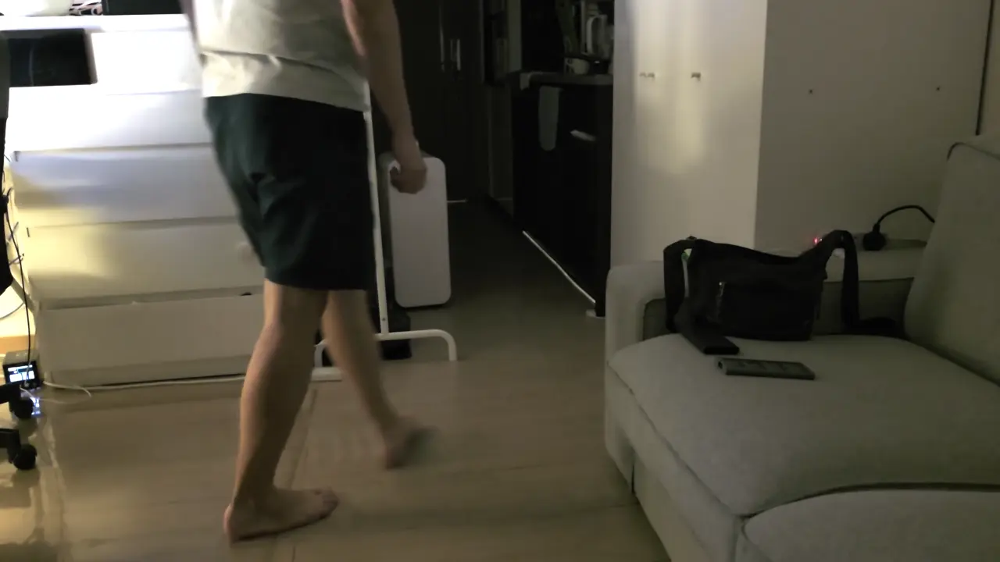
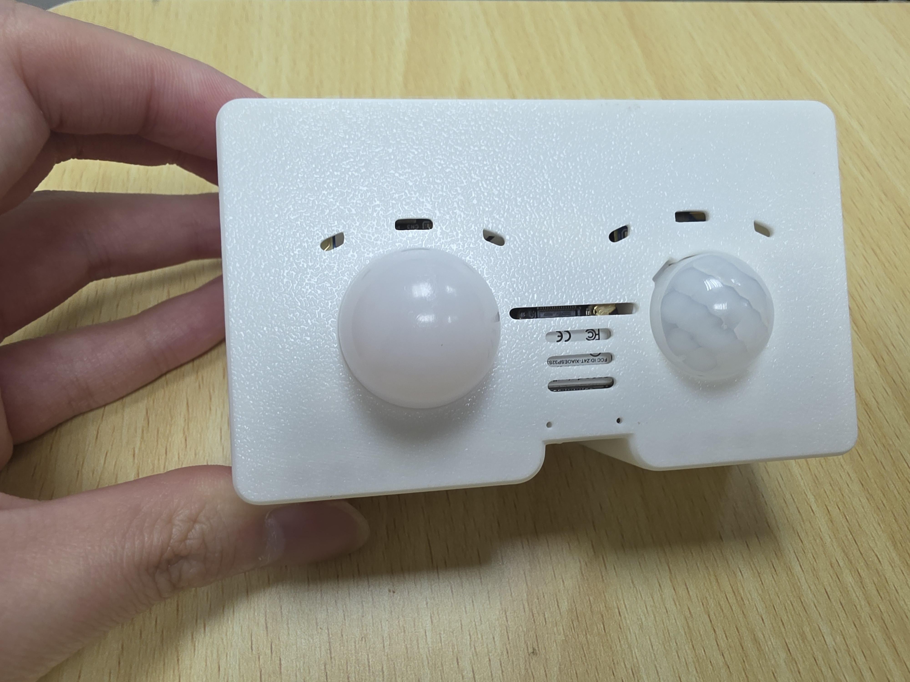
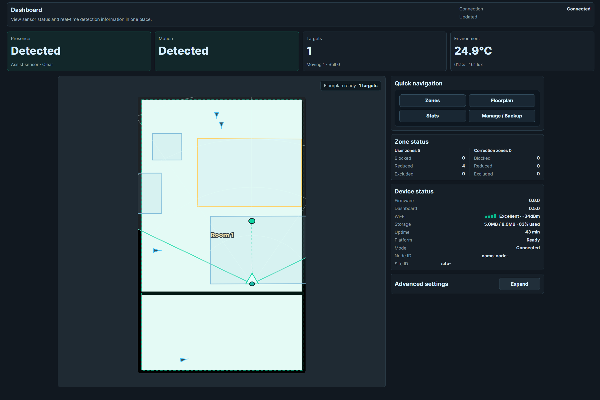
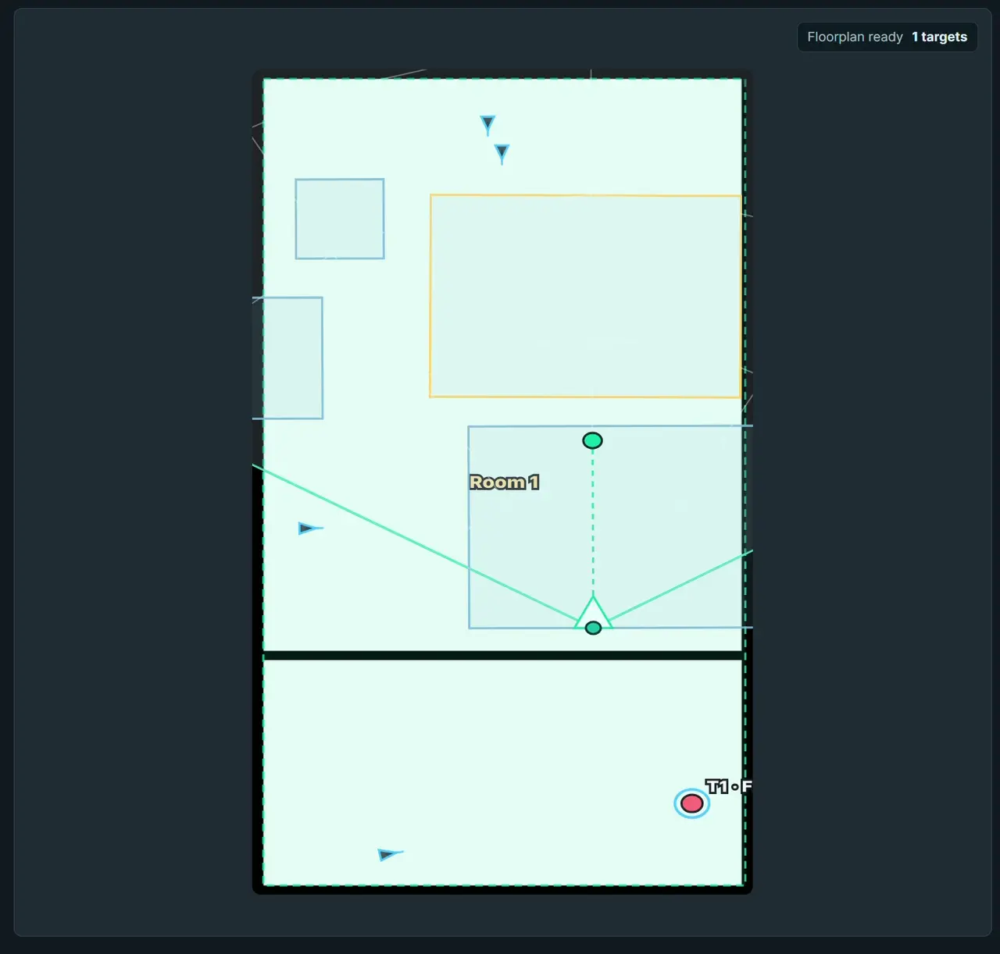

# NAMO

**NAMO Ain't Motion-Only.**

*Still here, even when you're still.*

NAMO is a fully local mmWave spatial presence platform with live floorplan
tracking, visual zones, multi-device coordinate fusion, and Home Assistant
integration.

NAMO는 실시간 평면도 추적, 시각적 감지 구역, 다중 기기 좌표 융합 및 Home
Assistant 연동을 제공하는 완전한 로컬 방식의 mmWave 공간 재실 플랫폼입니다.

*NAMO follows movement between zones and drives local room automation without a
cloud service. / NAMO는 클라우드 서비스 없이 구역 사이의 움직임을 추적하고
공간 자동화를 실행합니다.*

## Project Gallery / 프로젝트 사진

*Finished NAMO dual-radar device and enclosure / 완성된 NAMO 듀얼 레이더 기기와 케이스*

*Multiple NAMO devices installed in one floorplan / 하나의 평면도에 설치된 여러 NAMO 기기*

*Live fused targets on the dashboard / 대시보드에 표시된 실시간 융합 타깃*

## English

### Highlights

- Fully local operation on an ESP32; no cloud service is required.
- Live tracking of up to three radar targets.
- Uploaded or manually drawn floorplans with room, wall, door, and furniture
  editing.
- Detection, exclusion, correction, and exit zones.
- Optional LD2410C assistance for retaining an established presence session.
- Secure local pairing and coordinate fusion across multiple NAMO devices.
- Embedded web dashboard, backup and recovery, signed firmware updates, and a
  Home Assistant custom integration.

Try the browser-only [dashboard demo](https://david2766.github.io/NAMO-aint-motion-only/)
or the [initial setup demo](https://david2766.github.io/NAMO-aint-motion-only/?setup=1).
Mock mode does not change a real device.

### Install

Most users should install a prebuilt image from
[GitHub Releases](https://github.com/David2766/NAMO-aint-motion-only/releases/latest).

1. Download the `factory` image for the first USB installation.
2. Open [ESPHome Web](https://web.esphome.io/) in Chrome or Edge.
3. Connect the XIAO ESP32S3 and install the downloaded image.
4. Join the temporary setup AP and open `http://192.168.4.1/setup`.
5. Complete Wi-Fi setup and keep the displayed ESPHome API encryption key.

Use the `ota` image only when updating an installed device from its dashboard.
The complete procedure is in [Getting Started](https://github.com/David2766/NAMO-aint-motion-only/wiki/Getting-Started).

### Multi-Device Fusion

NAMO can pair multiple local devices, share one floorplan, calibrate each radar
into the same coordinate system, and fuse their observations into stable logical
targets. Configuration Owner, Site Leader, and Group Leader roles are selected
and handed over automatically; users do not assign them manually.

- One Fusion Group is bounded to a maximum of seven NAMO devices.
- Each device keeps its own radar placement and calibration on the shared
  floorplan.
- Standalone local sensing remains available when no Group is configured or
  distributed authority is temporarily unavailable.
- The complete pairing, calibration, activation, single-role failure, paired-role
  failure, and rejoin workflow has passed physical testing on a five-device,
  single-Group installation.
- Physical four-, six-, and seven-device matrices, multi-Group installations, and
  rolling firmware upgrades remain release-validation work.

See [Multi-Device Setup](https://github.com/David2766/NAMO-aint-motion-only/wiki/Multi-Device-Setup)
for pairing, floorplan selection, calibration, removal, and recovery instructions.

### Hardware

The reference build uses a Seeed Studio XIAO ESP32S3 with 8MB Flash / 8MB PSRAM
and an LD2450-series radar. LD2410C presence assistance, PIR, light, and
environmental sensors are optional.

See the [hardware guide](hardware/README.md) for the parts list, pinout, PCB files,
wiring, enclosure models, and DIY instructions. The current dual-sensor enclosure
uses [`top_dual.3mf`](hardware/enclosure/top_dual.3mf) and
[`bottom_dual.3mf`](hardware/enclosure/bottom_dual.3mf) as a matching pair. Its
locking interface is not compatible with the legacy single-sensor
[`bottom.3mf`](hardware/enclosure/bottom.3mf).

### Documentation

| Topic | Link |
| --- | --- |
| User guide | [GitHub Wiki](https://github.com/David2766/NAMO-aint-motion-only/wiki) |
| First installation | [Getting Started](https://github.com/David2766/NAMO-aint-motion-only/wiki/Getting-Started) |
| Dashboard | [Dashboard Guide](https://github.com/David2766/NAMO-aint-motion-only/wiki/Dashboard-Guide) |
| Floorplans and rooms | [Floorplan Setup](https://github.com/David2766/NAMO-aint-motion-only/wiki/Floorplan-Setup) |
| Detection zones | [Zone Setup](https://github.com/David2766/NAMO-aint-motion-only/wiki/Zone-Setup) |
| Multi-device operation | [Multi-Device Setup](https://github.com/David2766/NAMO-aint-motion-only/wiki/Multi-Device-Setup) |
| Home Assistant | [Home Assistant](https://github.com/David2766/NAMO-aint-motion-only/wiki/Home-Assistant) |
| Updates and recovery | [Firmware, Backup, and Recovery](https://github.com/David2766/NAMO-aint-motion-only/wiki/Firmware-Backup-Recovery) |
| Troubleshooting | [Troubleshooting](https://github.com/David2766/NAMO-aint-motion-only/wiki/Troubleshooting) |
| Developer entry point | [Developer Guide](https://github.com/David2766/NAMO-aint-motion-only/wiki/Developer-Guide) |
| Technical documentation | [Repository documentation](docs/README.md) |

### Status

<!-- release-firmware-version -->
NAMO v0.6.0 is a public beta.

The five-device single-Group workflow described above is physically verified.
The bounded host simulation covers two through seven processes, but it does not
replace the remaining physical-device release matrix. Exact implementation and
verification status is maintained in the
[implementation roadmap](docs/platform/implementation-roadmap.md).

### Security

> **Never expose a NAMO device or its embedded dashboard directly to the public
> internet.** NAMO is designed for trusted local networks. Use a properly
> authenticated VPN when remote access is required.

Each device should use its own ESPHome API encryption key. Never distribute a
firmware image containing personal Wi-Fi credentials, private keys, or local
configuration. Read the [network security guide](https://github.com/David2766/NAMO-aint-motion-only/wiki/Network-Security)
before enabling remote access or integrating third-party devices.

## 한국어

### 주요 기능

- 클라우드 없이 ESP32에서 완전히 로컬로 작동합니다.
- 레이더 타깃을 최대 3개까지 실시간으로 추적합니다.
- 평면도 업로드와 직접 그리기를 지원하며 방, 벽, 문 및 가구를 편집할 수
  있습니다.
- 감지, 제외, 오탐 보정 및 퇴실 구역을 설정할 수 있습니다.
- 선택 사양인 LD2410C로 이미 시작된 재실 상태의 유지를 보조합니다.
- 여러 NAMO 기기를 안전하게 로컬 연결하고 좌표를 융합합니다.
- 기기 내장 대시보드, 백업과 복구, 서명된 펌웨어 업데이트 및 Home Assistant
  사용자 정의 통합을 제공합니다.

브라우저에서 [대시보드 데모](https://david2766.github.io/NAMO-aint-motion-only/)와
[초기 설정 데모](https://david2766.github.io/NAMO-aint-motion-only/?setup=1)를 체험할 수
있습니다. 데모 모드는 실제 기기를 변경하지 않습니다.

### 설치

일반 사용자는 [GitHub Releases](https://github.com/David2766/NAMO-aint-motion-only/releases/latest)의
미리 빌드된 펌웨어를 사용하는 것이 좋습니다.

1. 최초 USB 설치에는 `factory` 이미지를 받습니다.
2. Chrome 또는 Edge에서 [ESPHome Web](https://web.esphome.io/)을 엽니다.
3. XIAO ESP32S3를 연결하고 받은 이미지를 설치합니다.
4. 임시 설정 AP에 연결하고 `http://192.168.4.1/setup`을 엽니다.
5. Wi-Fi 설정을 완료하고 화면에 표시된 ESPHome API 암호화 키를 보관합니다.

이미 설치된 기기를 대시보드에서 업데이트할 때에만 `ota` 이미지를 사용하세요.
전체 절차는 [시작하기](https://github.com/David2766/NAMO-aint-motion-only/wiki/Getting-Started-ko)에서
확인할 수 있습니다.

### 다중 기기 융합

여러 NAMO 기기를 로컬에서 안전하게 연결하고 하나의 평면도를 공유한 뒤, 각
레이더를 같은 좌표계에 보정하여 관측 결과를 논리적인 타깃으로 융합할 수
있습니다. Configuration Owner, Site Leader 및 Group Leader 역할은 자동으로
선출·승계되므로 사용자가 직접 지정하지 않습니다.

- Fusion Group 하나에는 NAMO 기기를 최대 7대까지 구성할 수 있습니다.
- 각 기기는 공유 평면도 안에서 자신의 레이더 위치와 보정 정보를 유지합니다.
- Group이 없거나 분산 권한을 일시적으로 사용할 수 없을 때에도 각 기기의 로컬
  단독 감지는 유지됩니다.
- 5대 단일 Group 환경에서 전체 페어링, 보정, 활성화, 단일 역할 장애, 역할 기기
  두 대의 동시 장애 및 복귀 흐름을 실기기로 검증했습니다.
- 4·6·7대 실기기 조합, 다중 Group 및 서로 다른 펌웨어의 순차 업데이트 검증은
  아직 남아 있습니다.

연결, 평면도 선택, 보정, 제거 및 복구 절차는
[다중 기기 설정](https://github.com/David2766/NAMO-aint-motion-only/wiki/Multi-Device-Setup-ko)을
참고하세요.

### 하드웨어

기준 구성은 8MB Flash / 8MB PSRAM 사양의 Seeed Studio XIAO ESP32S3와 LD2450
계열 레이더를 사용합니다. LD2410C 재실 보조, PIR, 조도 및 환경 센서는 선택
사양입니다.

부품 목록, 핀맵, PCB 파일, 배선, 케이스 모델 및 자작 방법은
[하드웨어 가이드](hardware/README.ko.md)를 참고하세요. 현재 듀얼 센서 케이스는
[`top_dual.3mf`](hardware/enclosure/top_dual.3mf)와
[`bottom_dual.3mf`](hardware/enclosure/bottom_dual.3mf)를 한 쌍으로 사용합니다.
잠금 구조가 변경되어 구형 단일 센서용
[`bottom.3mf`](hardware/enclosure/bottom.3mf)와는 호환되지 않습니다.

### 문서

| 주제 | 링크 |
| --- | --- |
| 사용자 안내 | [GitHub Wiki](https://github.com/David2766/NAMO-aint-motion-only/wiki) |
| 최초 설치 | [시작하기](https://github.com/David2766/NAMO-aint-motion-only/wiki/Getting-Started-ko) |
| 대시보드 | [대시보드 사용법](https://github.com/David2766/NAMO-aint-motion-only/wiki/Dashboard-Guide-ko) |
| 평면도와 방 | [평면도 설정](https://github.com/David2766/NAMO-aint-motion-only/wiki/Floorplan-Setup-ko) |
| 감지 구역 | [구역 설정](https://github.com/David2766/NAMO-aint-motion-only/wiki/Zone-Setup-ko) |
| 다중 기기 | [다중 기기 설정](https://github.com/David2766/NAMO-aint-motion-only/wiki/Multi-Device-Setup-ko) |
| Home Assistant | [Home Assistant](https://github.com/David2766/NAMO-aint-motion-only/wiki/Home-Assistant-ko) |
| 업데이트와 복구 | [펌웨어·백업·복구](https://github.com/David2766/NAMO-aint-motion-only/wiki/Firmware-Backup-Recovery-ko) |
| 문제 해결 | [문제 해결](https://github.com/David2766/NAMO-aint-motion-only/wiki/Troubleshooting-ko) |
| 개발자 안내 | [개발자 가이드](https://github.com/David2766/NAMO-aint-motion-only/wiki/Developer-Guide-ko) |
| 기술 문서 | [저장소 개발 문서](docs/README.ko.md) |

### 개발 상태

<!-- release-firmware-version -->
NAMO v0.6.0는 공개 베타입니다.

위에서 설명한 5대 단일 Group 흐름은 실기기로 검증했습니다. 2~7개 프로세스를
사용하는 제한형 호스트 시뮬레이션도 통과했지만, 이는 남아 있는 실기기 릴리즈
검증을 대체하지 않습니다. 정확한 구현 및 검증 상태는
[구현 로드맵](docs/platform/implementation-roadmap.ko.md)에서 관리합니다.

### 보안

> **NAMO 기기와 내장 대시보드를 공개 인터넷에 절대로 직접 노출하지 마세요.**
> NAMO는 신뢰할 수 있는 로컬 네트워크 사용을 전제로 합니다. 외부 접속이
> 필요하다면 인증된 VPN을 사용하세요.

기기마다 서로 다른 ESPHome API 암호화 키를 사용해야 합니다. 개인 Wi-Fi 정보,
비밀 키 또는 로컬 설정이 포함된 펌웨어 이미지를 배포하지 마세요. 외부 접속이나
타사 기기 연동 전에는
[네트워크 보안 안내](https://github.com/David2766/NAMO-aint-motion-only/wiki/Network-Security-ko)를
확인하세요.

## Source and License / 소스와 라이선스

- Firmware and embedded dashboard / 펌웨어와 내장 대시보드:
  <https://github.com/David2766/NAMO-aint-motion-only>
- Home Assistant custom card / Home Assistant 사용자 정의 카드:
  <https://github.com/David2766/radar-zone-card-for-LD2450>
- SmartThings Edge Driver:
  <https://github.com/David2766/presence-sensor-smartthings-edge>

Software and firmware are licensed under AGPL-3.0-or-later. Hardware files under
[`hardware/`](hardware/) use the separate
[CC BY-NC-SA 4.0 license](hardware/LICENSE). Third-party components retain their
own licenses; see [Third-Party Notices](THIRD_PARTY_NOTICES.md) and
[Third-Party License Texts](THIRD_PARTY_LICENSES.txt).

소프트웨어와 펌웨어에는 AGPL-3.0-or-later가 적용됩니다. [`hardware/`](hardware/)
아래의 하드웨어 파일에는 별도의 [CC BY-NC-SA 4.0 라이선스](hardware/LICENSE)가
적용됩니다. 외부 구성요소에는 각 구성요소의 라이선스가 적용되며 자세한 내용은
[외부 구성요소 고지](THIRD_PARTY_NOTICES.md)와
[외부 라이선스 전문](THIRD_PARTY_LICENSES.txt)을 참고하세요.
